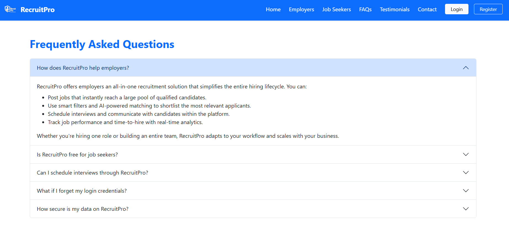

**Course Training in Full Stack Development**
----

**TECH STACK USED**: Java, SpringBoot, MERN basics, C++, OS basics, Mysql

----
**Project Links** 

[Recruitment Platform](https://github.com/dsaha21/Summary_Book/tree/main),

<!--  -->

<!-- Since this post doesn't specify an explicit `image`, the first image in the post will be used in the listing page of posts. -->
